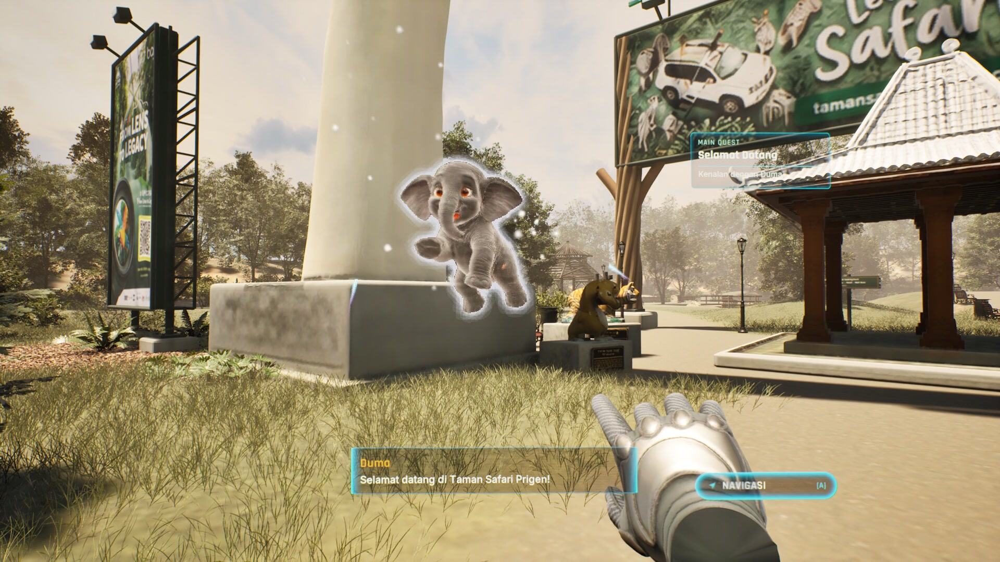
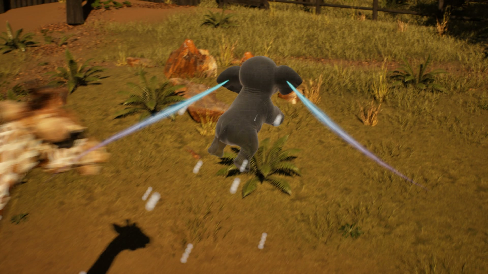
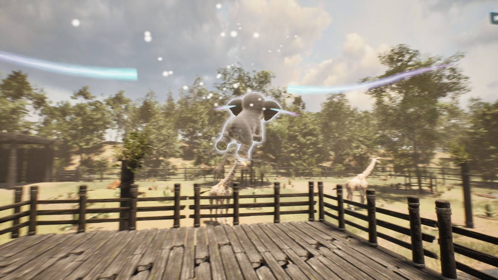
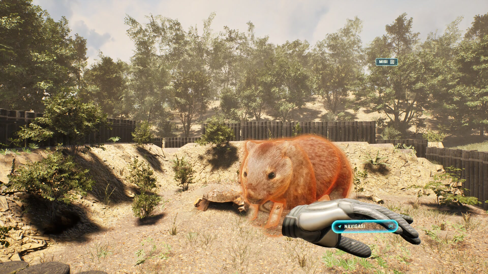
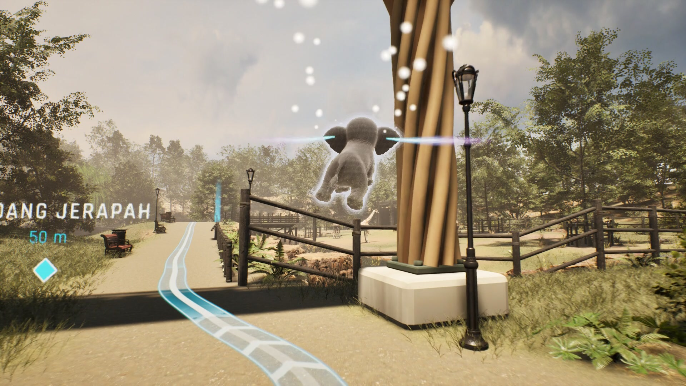
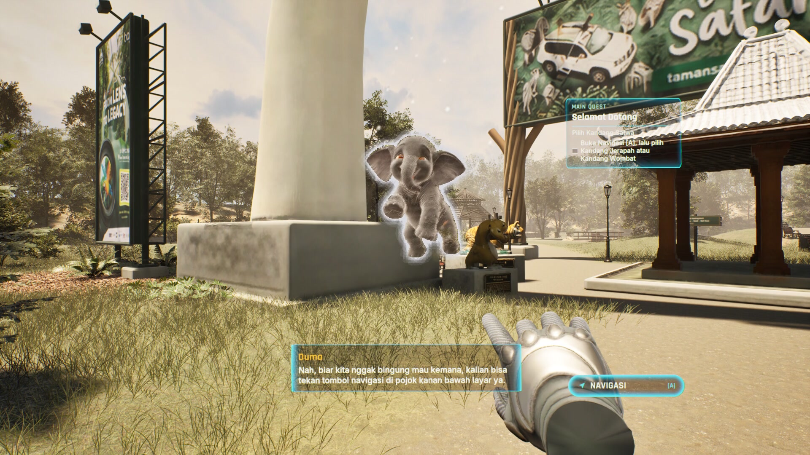
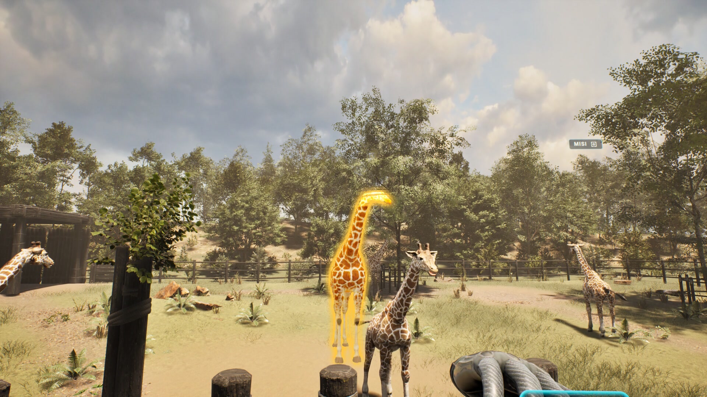
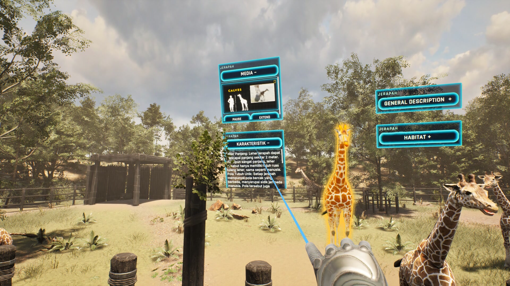
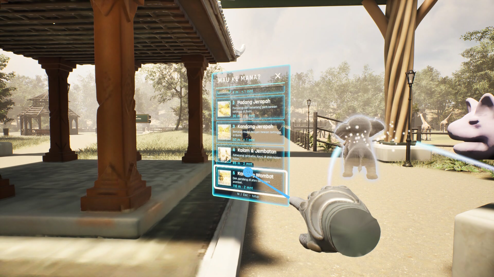

# Taman Safari VR Exhibit

**An interactive VR guided safari tour and spatial AR exhibit for Taman Safari Prigen, built in Unreal Engine 5.8 with C++ for Meta Quest (OpenXR).**

Project by **Eka Putra Meravigliosi** ([@EkaPutra0856](https://github.com/EkaPutra0856)): Game Developer & Team Lead — level design, VR/AR gameplay programming, AI mascot guidance system, and showcase cinematics.

> **Demonstration Media & Videos:**
> - [Google Drive: AR Simulation Portfolio & Showcase](https://drive.google.com/file/d/1r4Tb66vd3TBGypGh7TkD7mkQiIKZQP7_/view?usp=drive_link)
> - [Google Drive: Full VR Demo (POV Quest 5:38)](https://drive.google.com/file/d/1r4Tb66vd3TBGypGh7TkD7mkQiIKZQP7_/view?usp=drive_link)



---

## Overview

Taman Safari VR is an immersive virtual safari experience developed for **Meta Quest headsets**. The project recreates the natural animal sanctuaries of Taman Safari Prigen, combining open park navigation, spatial AR exhibits, and an AI-driven flying mascot guide (**Duma**, a baby Sumatran elephant hologram).

Visitors walk through themed safari biomes, choose destinations from a floating 3D spatial menu, follow an organic 3D floor ribbon route, and inspect animal exhibits. Upon arrival, full-scale animal holograms materialize through a spatial scanning effect, accompanied by multi-tier interactive AR information cards (video playback, physical characteristics, and habitat information).

> **Note on Repository Contents:**
> This repository contains the **complete C++ source code, plugin modules (`WzSystem`), configuration files, pipeline tools, and technical documentation**. Proprietary 3D art packs, megascans, and audio assets (~23 GB `Content/` folder) are excluded to respect third-party licensing and repository size limits.

---

## Key Highlights

- **Full 6-DOF VR Experience:** Built natively on Unreal Engine 5.8 using **OpenXR** and the **Meta XR / OculusXR** plugin for Meta Quest (Link / Air Link).
- **Hybrid Input System:** Seamlessly switches between full VR (headset tracking, 45° snap turns, dual motion controllers, right-hand laser pointer) and desktop mode for testing.
- **Organic 3D Waypoint Navigation (`WzSystem: PathGuide`):** Polyline floor ribbons that hug terrain contours, waypoint beacons, arrival toasts, and automatic path recalculation.
- **Autonomous AI Mascot Guide (Duma):** A floating baby Sumatran elephant with spline flight paths, contextual greeting/dialogue, and sightline anti-occlusion algorithms.
- **Interactive Spatial AR Panels:** Expandable floating 3D information cards (Media Video Player, Characteristics, General Description, Habitat) that lazily track visitor head orientation.
- **Clean C++ Architecture:** Modular design split across `VR/`, `AR/`, `Duma/`, `UI/`, and the standalone `WzSystem` plugin (~17k lines of C++).



---

## Level Design & Spatial Philosophy

### 1. Park Zoning & Natural Biomes
The virtual safari park is structured as an organic, readable circuit divided into distinct ecological zones:

| Zone / Landmark | Architectural Theme | Level Design & Focal Purpose |
|---|---|---|
| **Arrival Plaza & Main Gate** | Traditional Indonesian safari architecture, rustic timber framing | Orientation area, player calibration, Duma introduction dialogue |
| **Wetland Sanctuary & Canal** | Natural waterways, reeds, riparian trees | Natural boundary separating zones without immersion-breaking artificial cages |
| **Giraffe Viewing Deck** | Elevated heavy-timber wooden walkway and observation platform | Positions visitor eye-level with giraffe head (~3.5m elevation), creating an intimate viewing angle |
| **Nocturnal & Terrestrial Habitat (Wombat Enclosure)** | Earth mounds, burrow rock formations, shade canopy | Low-profile rocks and sunken ground plane optimized for ground-dwelling fauna |



### 2. Sightlines, Focal Points, and Natural Framing
- **Curved Path Pacing:** Rather than straight utilitarian corridors, visitor routes follow gentle, natural curves. Major animal enclosures are revealed gradually as the visitor rounds a bend, maximizing sense of discovery.
- **Natural Immersion Barriers:** Fences, rivers, and rock formations serve as functional collision boundaries that feel entirely diegetic to the safari setting.
- **Viewing Station Ergonomics:** Each exhibit features a designated primary viewing station with calibrated focal distance:
  - *Large Megafauna (Giraffe):* 6–8 meters distance, elevated platform to eliminate neck strain.
  - *Small Mammals (Wombat):* 2.5–3.5 meters viewing radius with open sightline over rock borders.



### 3. Spatial Wayfinding: Organic 3D Route Guidance
Navigating large open-air VR environments can cause disorientation. The `PathGuide` system solves this without breaking immersion:
- **Terrain-Adhering 3D Ribbon:** A luminescent ground ribbon traces the exact walkway contours, projecting directly onto the ground plane.
- **Dynamic Waypoint Beacons & Pins:** World-space pins project remaining distance in meters. When the visitor is within 5 meters of the destination, the pin smoothly fades out to unclutter the exhibit.
- **Arrival Detection:** Spatial trigger volumes trigger an arrival toast and automatically activate the exhibit's presentation sequence.



---

## Flying Mascot AI: Duma

The guide mascot is **Duma**, an energetic baby Sumatran elephant rendered as an interactive floating hologram.



- **Flight AI & Spatial Positioning:**
  - Duma maintains an orbital position 1.8 meters in front of the player, tilted 25° upward in the peripheral vision.
  - **Sightline Anti-Occlusion:** When the visitor approaches an animal exhibit or when AR panels open, Duma dynamically computes the visitor's gaze vector and glides to a flanking position to avoid obstructing the exhibit view or interface text.
- **Contextual Narrative & Voice System:**
  - Welcomes the visitor at the main gate with voice-acted Indonesian audio and synchronized speech subtitles.
  - Reacts dynamically to chosen destinations and gives hints along the route.

---

## Interactive Spatial AR & Exhibit System

### 1. Spatial Scan & Hologram Materialize
When the player arrives at an animal station:
1. A 3D cylindrical scan line sweeps across the exhibit area.
2. The animal hologram materializes with particle effects and an ambient chime.
3. The exhibit enters presentation mode, turning toward the visitor's optimal viewing angle.



### 2. Multi-Tier AR Info Cards
A set of spatial cards opens in 3D world space beside the animal:
- **MEDIA Card:** Embedded video player showcasing real-world safari footage.
- **KARAKTERISTIK Card:** Scientific taxonomy, lifespan, weight, and conservation status.
- **GENERAL DESCRIPTION Card:** Scrollable contextual narrative explaining the species' role in Indonesian biodiversity.
- **HABITAT Card:** Visual biome breakdown and geographical distribution map.



### 3. Destination Menu
Pressing controller button **A** opens a curved spatial destination picker:
- Lists all active exhibits with thumbnail previews and estimated walking distance.
- Selecting an item immediately updates the `PathGuide` ribbon and sends Duma along the route.



---

## VR Comfort & Ergonomics

- **Locomotion:** Head-relative continuous walking coupled with **45° snap turning** on the right thumbstick (smooth rotation disabled to prevent vestibular mismatch).
- **Lazy-Follow Floating UI:** Floating panels do not rigidly lock to the headset view. Instead, they remain stationary for subtle head movements (< 35°) and smoothly recenter when the visitor turns significantly or walks.
- **Laser Interaction:** The right-hand controller emits a subtle 10-meter laser ray with haptic feedback, activating only when pointed at interactive widgets or exhibit elements.
- **Performance Profiling:** Custom console variable profiles adjust shadow cascades, anti-aliasing (TSR/MSAA), and foveated rendering specifically when VR rendering is active.

---

## Architecture & Code Structure

```
D:/Projek UE/PortfolioRepos/tamansafari-vr-exhibit/
├── Config/                     # Engine, input mappings, and project defaults
│   ├── DefaultEngine.ini       # GameMode and render pipeline overrides
│   ├── DefaultInput.ini        # Enhanced Input Actions & Contexts
│   └── DefaultGame.ini
├── Docs/                       # Technical specifications, Perforce guides, & screenshots
│   ├── Screenshots/            # 1080p high-resolution showcase captures
│   ├── PathGuide/              # UI mockups and routing graph documentation
│   └── VR_COPY_CHANGES.md      # Detailed VR architecture and implementation log
├── Plugins/
│   └── WzSystem/               # Standalone reusable gameplay and UI plugin
│       ├── Source/             # PathGuide routing subsystem, MVC widget controllers
│       └── WzSystem.uplugin
├── Source/
│   ├── Zoo/
│   │   ├── AR/                 # ZooARExhibit, CameraFocus, HabitatMath, Presentation
│   │   ├── Duma/               # Mascot AI controller, motion spline, show component
│   │   ├── Hologram/           # Hologram profile data and scan VFX component
│   │   ├── UI/                 # Info widgets, quest peek, HUD controller
│   │   └── VR/                 # UZooVRComponent, AZooVRGameMode, PanelHost, DemoDirector
│   ├── Zoo.Target.cs
│   └── ZooEditor.Target.cs
├── Tools/                      # Pipeline scripts and helper utilities
└── Zoo.uproject                # UE 5.8 project descriptor (OpenXR, OculusXR enabled)
```

---

## Author & Credits

- **Project Lead & Developer:** Eka Putra Meravigliosi ([@EkaPutra0856](https://github.com/EkaPutra0856))
- **Role:** Game Developer & Team Lead — Level Design, VR/AR Programming, Narrative & AI Integration, Media Production.
- **Client / Organization:** PT Global Impian Teknologi (Exorlens) for Taman Safari Prigen.
